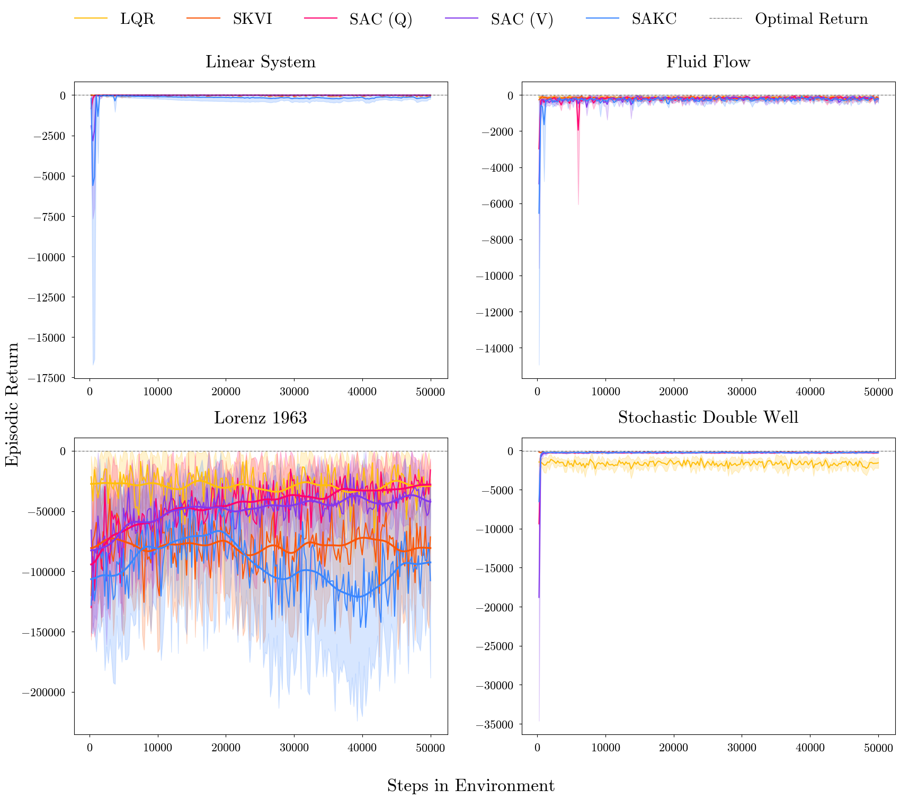

# KARL Experiments Reproduction

This repository contains an **independent implementation, theoretical investigation, and experimental evaluation** of the algorithms presented in:

> **Koopman-Assisted Reinforcement Learning**  
> Preston Rozwood et al.  
> [Original KARL paper (2024)](https://arxiv.org/abs/2403.02290v1)

The project was developed as part of a Master's thesis in **Mathematics in Science and Engineering** at the Technical University of Munich (TUM).

**Thesis title:** *Theoretical Analysis and Experimental Evaluation of Koopman-Assisted Reinforcement Learning*

**Project status:** Master's thesis completed (October 2026).

The main objective is to understand and independently reproduce the behavior of two Koopman-assisted reinforcement learning algorithms:

- **Soft Koopman Value Iteration (SKVI)**
- **Soft Actor Koopman-Critic (SAKC)**

The evaluation covers four benchmark dynamical systems and compares the Koopman-assisted methods with conventional reinforcement learning and control baselines.

An additional investigation of the Lorenz system was conducted using configurations guided by the revised KARL paper, referred to here as **KARLv2**.

## Implemented Algorithms

The following algorithms are included:

- **SKVI** — Soft Koopman Value Iteration
- **SAKC** — Soft Actor Koopman-Critic
- **SAC(V)** — Soft Actor-Critic with a value-function formulation
- **SAC(Q)** — Soft Actor-Critic with a Q-function formulation
- **LQR** — Linear Quadratic Regulator

The corresponding agent implementations are:

```text
skvi_agent.py
sakc_agent.py
sac_v_agent.py
sac_q_agent.py
```

The repository also includes two modified Koopman-assisted agent implementations:

```text
skvi_agent_v2.py
sakc_agent_v2.py
```

These versions were developed for the KARLv2-guided follow-up experiment on the Lorenz system.

The SAC baselines were implemented independently rather than directly using existing CleanRL implementations.

LQR is implemented within the environment training scripts rather than as a separate agent file.

## Benchmark Environments

The experiments cover the four dynamical systems considered in the original KARL study:

1. **Linear System** — A discrete-time linear state-space model.
2. **Fluid Flow** — A reduced-order model of fluid flow past a cylinder.
3. **Lorenz System** — A nonlinear system exhibiting chaotic dynamics.
4. **Stochastic Double-Well System** — A nonlinear stochastic dynamical system.

The corresponding training scripts are:

```text
linear_system_training.py
fluid_flow_training.py
Lorenz_training.py
double_well_training.py
```

An additional training script is provided for the revised Lorenz experiment:

```text
Lorenz_training_v2.py
```

The original scripts are retained to preserve the initial replication configurations.

## Repository Structure

```text
KARL-experiments-reproduction/
├── linear_system_training.py
├── fluid_flow_training.py
├── Lorenz_training.py
├── Lorenz_training_v2.py
├── double_well_training.py
│
├── skvi_agent.py
├── skvi_agent_v2.py
├── sakc_agent.py
├── sakc_agent_v2.py
├── sac_v_agent.py
├── sac_q_agent.py
│
├── reward_curves.png
└── README.md
```

Additional directories may be generated during training to store model parameters and episodic reward data.

## Methodology

The Koopman-assisted algorithms combine data-driven approximations of nonlinear dynamical systems with reinforcement learning.

For the Koopman-based methods, state-action transition data are collected to construct a finite-dimensional approximation of an action-dependent Koopman operator.

A Koopman tensor is estimated using polynomial dictionaries of state and action observables.

The resulting representation is incorporated into two reinforcement learning algorithms:

- **SKVI** performs entropy-regularized value iteration using a Koopman-based approximation of the value function.
- **SAKC** retains an actor-critic structure while incorporating the Koopman representation into value estimation and Bellman updates.

The two methods are compared against SAC(V), SAC(Q), and LQR.

The experiments evaluate episodic returns over five random seeds.

## Experimental Results

### Initial Replication

The initial experiments independently evaluate all five methods across the four benchmark environments.

The results reproduce several qualitative characteristics reported in the original KARL study, although the relative performance ordering is not consistently recovered.

The main observations are:

- **Linear System:** The Koopman-assisted methods achieve relatively stable performance but remain below the leading benchmark methods.
- **Fluid Flow:** The Koopman-assisted algorithms demonstrate competitive performance, particularly SKVI.
- **Lorenz System:** The initial replication exhibits a substantial discrepancy from the original study, especially in the performance of SKVI.
- **Stochastic Double-Well System:** The learning-based controllers generally outperform LQR, with SAKC showing an advantage during the early training phase.

These results demonstrate that Koopman-assisted reinforcement learning can produce competitive controllers, but its relative performance depends on the dynamical environment and experimental configuration.

### KARLv2-Guided Lorenz Follow-Up

A revised version of the KARL paper was released in May 2026:

> [Koopman-Assisted Reinforcement Learning — Version 2 (KARLv2)](https://arxiv.org/abs/2403.02290v2)

The revised study provides more detailed experimental configurations and environment-specific hyperparameters.

Motivated by the discrepancy observed in the initial Lorenz replication, an additional experiment was conducted using configurations guided by KARLv2.

Three modified Python files are provided:

| Original implementation | Revised implementation |
|---|---|
| `Lorenz_training.py` | `Lorenz_training_v2.py` |
| `skvi_agent.py` | `skvi_agent_v2.py` |
| `sakc_agent.py` | `sakc_agent_v2.py` |

The modified versions introduce several changes to the experimental configuration.

For **SKVI**, these include:

- Adjusted state batch size and training epochs
- Modified entropy coefficient
- Revised initialization of value-function coefficients
- Modified action dictionary
- Revised Koopman training dataset

For **SAKC**, these include:

- A random-policy data collection phase before learning
- Automatic entropy coefficient tuning
- Modified actor and critic network architectures
- Revised actor update schedule
- Adjusted learning rates
- Revised Koopman training dataset

Additional changes include:

- Separate Koopman tensors for SKVI and SAKC
- Double-precision numerical computation

The follow-up experiment improves the performance of both Koopman-assisted algorithms on the Lorenz system, particularly SAKC.

However, the resulting performance ordering still differs from that reported in KARLv2.

**Important:** This follow-up is not intended as an exact reproduction of the complete KARLv2 evaluation protocol. It investigates the effect of adopting selected configurations from the revised study while retaining the independently implemented experimental framework.

The results indicate that implementation details, hyperparameter choices, and Koopman tensor construction can substantially influence the empirical performance of the algorithms.

## Reward Curves

The repository includes a comparison of episodic returns across the four benchmark environments.

The original reward-curve figure is shown below:



The figure should be interpreted according to the experimental configuration used to generate it. In particular, the KARLv2-guided Lorenz follow-up is a separate experiment and is not necessarily represented in the original four-environment figure.

## Requirements

The implementation is written in Python and primarily uses:

```text
numpy
torch
gymnasium
matplotlib
scipy
control
```

Package versions have not been fixed in a dedicated `requirements.txt` file.

## Running the Experiments

Each environment can be trained independently using its corresponding script.

### Linear System

```bash
python linear_system_training.py
```

### Fluid Flow

```bash
python fluid_flow_training.py
```

### Lorenz System — Initial Replication

```bash
python Lorenz_training.py
```

### Lorenz System — KARLv2-Guided Configuration

```bash
python Lorenz_training_v2.py
```

### Stochastic Double-Well System

```bash
python double_well_training.py
```

Depending on the experiment, the scripts may generate saved model parameters, episodic reward data, and reward-curve plots.

## Project Status and Limitations

The main experimental investigation and Master's thesis were completed in **October 2026**.

This repository represents an independent implementation and evaluation of the KARL algorithms rather than an exact numerical reproduction of the published results.

Several limitations should be considered:

- The experiments use five random seeds, whereas KARLv2 uses a more extensive statistical evaluation.
- The SAC baselines are independently implemented and may differ from the implementations used in the original studies.
- The KARLv2-guided follow-up modifies multiple settings simultaneously and does not isolate the effect of each individual parameter.
- The finite-dimensional Koopman approximation depends on the chosen dictionaries and the distribution of the training data.

The results highlight both the potential of Koopman-assisted reinforcement learning and the importance of experimental reproducibility.

## References

**Original KARL study (2024):**

Rozwood, P., et al. *Koopman-Assisted Reinforcement Learning*. arXiv:2403.02290v1.

https://arxiv.org/abs/2403.02290v1

**Revised KARL study (2026):**

Rozwood, P., et al. *Koopman-Assisted Reinforcement Learning*. arXiv:2403.02290v2.

https://arxiv.org/abs/2403.02290v2

**Original implementation repository:**

https://github.com/dynamicslab/KoopmanRL

## Acknowledgements

This repository is an independent academic implementation and experimental evaluation based on the Koopman-Assisted Reinforcement Learning framework.

The original KARL algorithms and experimental designs are credited to Rozwood et al.

The project was conducted as part of a Master's thesis at the Technical University of Munich.
